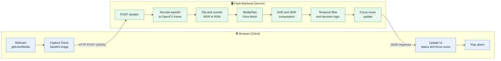
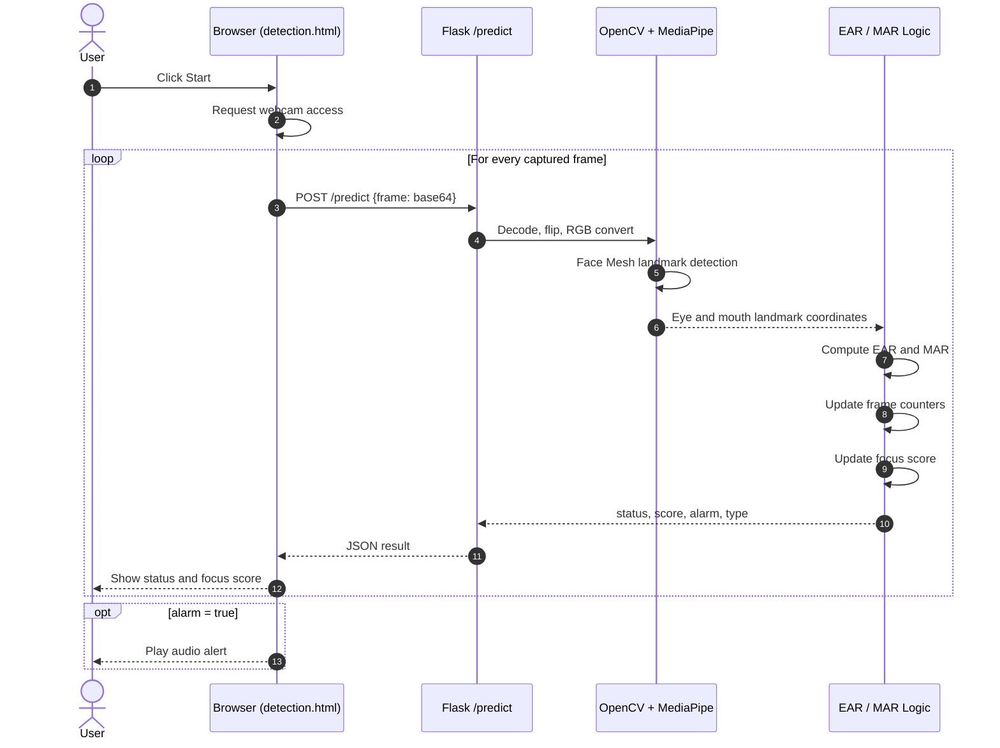
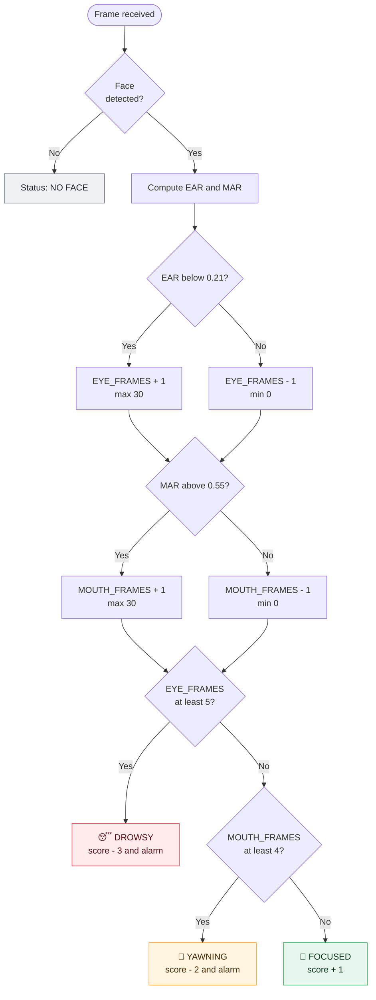
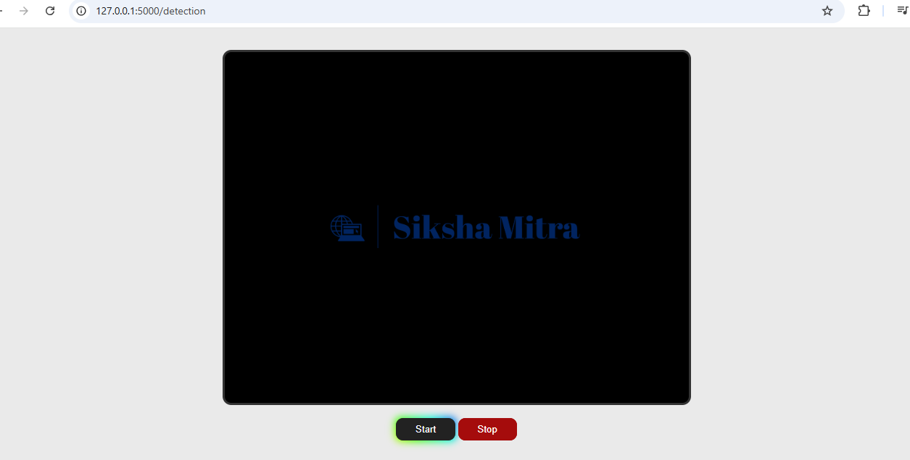
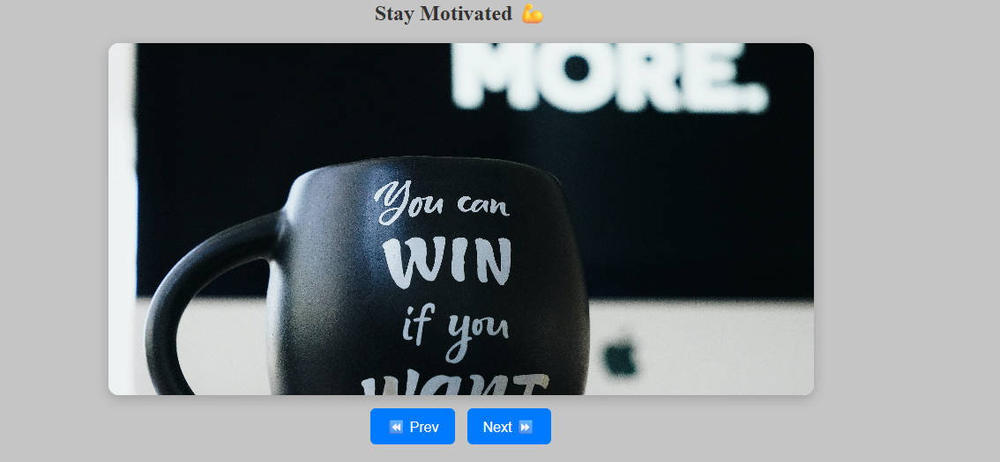

<div align="center">

# 💤 Student Drowsiness & Yawning Detection System

**A real-time, browser-based fatigue monitoring application that uses MediaPipe Face Mesh to compute the Eye Aspect Ratio (EAR) and Mouth Aspect Ratio (MAR), raises an audio alert on drowsiness or yawning, and keeps students focused with a live focus score, motivational quotes and study tips.**


[Repository](https://github.com/Chintucharan/detection_system) ·
[Report a Bug](https://github.com/Chintucharan/detection_system/issues) ·
[Request a Feature](https://github.com/Chintucharan/detection_system/issues)

</div>

---

## Table of Contents

1. [Abstract](#1-abstract)
2. [Problem Statement and Objectives](#2-problem-statement-and-objectives)
3. [Features](#3-features)
4. [System Architecture](#4-system-architecture)
5. [Methodology](#5-methodology)
6. [Implementation Details](#6-implementation-details)
7. [API Reference](#7-api-reference)
8. [Tech Stack](#8-tech-stack)
9. [Project Structure](#9-project-structure)
10. [Getting Started](#10-getting-started)
11. [Deployment](#11-deployment)
12. [Screenshots](#12-screenshots)
13. [Configuration and Threshold Tuning](#13-configuration-and-threshold-tuning)
14. [Limitations](#14-limitations)
15. [Applications](#15-applications)
16. [Future Scope](#16-future-scope)
17. [Troubleshooting](#17-troubleshooting)
18. [References](#18-references)
19. [Author](#19-author)

---

## 1. Abstract

Drowsiness and loss of attention during long study sessions reduce learning efficiency, and the same fatigue cues are a leading factor in driving and workplace incidents. This project presents a lightweight, real-time **fatigue detection web application** that needs only a standard webcam.

The browser streams webcam frames to a **Flask** backend. The backend uses **MediaPipe Face Mesh** to locate facial landmarks, computes the **Eye Aspect Ratio (EAR)** and **Mouth Aspect Ratio (MAR)**, and applies a **temporal frame-counting filter** to decide whether the user is *focused*, *drowsy* or *yawning*. On detection, the interface plays an audio alarm and lowers a **live focus score**. To support recovery, the application also serves motivational quotes and curated study tips with reference links.

The system uses a purely geometric, landmark-based approach: it needs **no model training and no dataset**, and it runs on CPU.

## 2. Problem Statement and Objectives

**Problem.** Students often lose focus or fall asleep during self-study and online classes, and rarely notice it until time has been lost. Manual self-monitoring is unreliable, and most commercial fatigue-monitoring solutions are built for vehicles and require specialised hardware.

**Objectives**

| # | Objective |
| :-: | --- |
| 1 | Detect prolonged eye closure (drowsiness) in real time from a webcam stream |
| 2 | Detect yawning using mouth geometry |
| 3 | Avoid false alarms from normal blinks or speech by requiring several consecutive frames |
| 4 | Alert the user immediately with an audio alarm |
| 5 | Quantify attentiveness through a continuously updated focus score |
| 6 | Encourage recovery with motivational quotes and study tips |
| 7 | Deliver everything through an accessible web interface, with no installation on the client |

## 3. Features

| | Feature | Description |
| :-: | --- | --- |
| 🎥 | **Real-time monitoring** | Continuous webcam analysis through the browser |
| 👁️ | **Drowsiness detection** | EAR-based eye-closure detection with a temporal filter |
| 🥱 | **Yawning detection** | MAR-based mouth-opening detection with a temporal filter |
| 🔔 | **Audio alert** | An alarm is triggered when fatigue is detected |
| 📊 | **Live focus score** | A 0–100 score that falls during fatigue and recovers while focused |
| 💬 | **Motivational quotes** | A curated pool of 20 quotes served on demand |
| 📖 | **Study tips** | Tips with reference links, loaded from an editable `tips.csv` |
| 🌐 | **Web interface** | Flask + Jinja2 templates; no client-side installation |
| ⚡ | **Lightweight** | CPU-only inference with a single face mesh |
| ☁️ | **Deploy-ready** | Includes `render.yaml`, `procfile` and Gunicorn configuration |

## 4. System Architecture

### 4.1 High-level architecture



### 4.2 Request lifecycle



### 4.3 Decision logic (state machine)



> **Priority rule:** drowsiness is evaluated before yawning, so if both conditions hold in the same frame the system reports **DROWSY**.

## 5. Methodology

### 5.1 Facial landmark detection

The system uses **MediaPipe Face Mesh**, which predicts **468 3D facial landmarks** (478 when `refine_landmarks=True`, which adds iris landmarks) from a single RGB image. Only six landmarks per eye and eight landmarks around the mouth are used.

| Region | Landmark indices (MediaPipe) |
| --- | --- |
| Left eye | `33, 160, 158, 133, 153, 144` |
| Right eye | `362, 385, 387, 263, 373, 380` |
| Mouth | `61, 291, 81, 178, 13, 14, 17, 402` |

### 5.2 Eye Aspect Ratio (EAR)

EAR was introduced by Soukupová and Čech (2016) for blink detection. With the six eye landmarks $p_1 \dots p_6$ ordered around the eye:

$$
EAR = \frac{\lVert p_2 - p_6 \rVert + \lVert p_3 - p_5 \rVert}{2 \, \lVert p_1 - p_4 \rVert}
$$

The numerator measures the two vertical eyelid distances and the denominator measures the horizontal eye width. EAR stays roughly constant while the eye is open and falls toward zero as it closes. The final EAR is the **average of the left and right eyes**, which reduces noise from head tilt and landmark jitter.

### 5.3 Mouth Aspect Ratio (MAR)

MAR applies the same idea to the mouth. In the implementation, with the mouth list indexed `m[0] … m[7]`:

$$
MAR = \frac{\lVert m_2 - m_6 \rVert + \lVert m_3 - m_5 \rVert}{2 \, \lVert m_0 - m_1 \rVert}
$$

Here $m_0, m_1$ are the **mouth corners** (landmarks 61 and 291), which give the width, and the other pairs measure the **vertical lip opening**. A wide-open mouth, as in a yawn, gives a high MAR.

### 5.4 Temporal filtering

A single frame is not enough to call someone drowsy, because a normal blink also produces a low EAR for a moment. The system therefore uses **leaky counters**:

| Counter | Increases (max 30) when | Decreases (min 0) when | Triggers at |
| --- | --- | --- | --- |
| `EYE_FRAMES` | `EAR < 0.21` | otherwise | `≥ 5` frames |
| `MOUTH_FRAMES` | `MAR > 0.55` | otherwise | `≥ 4` frames |

Because the counters decay by one instead of resetting to zero, brief recovery frames do not instantly cancel a developing detection. The cap of 30 stops a counter from growing unboundedly, so the alert clears quickly once the user recovers.

### 5.5 Focus score

A single integer in the range **0–100** (initial value **80**) summarises recent attentiveness:

| State | Score change per processed frame |
| --- | :-: |
| 😴 Drowsy | **−3** |
| 🥱 Yawning | **−2** |
| 🙂 Focused | **+1** |
| No face detected | unchanged |

Fatigue lowers the score faster than focus restores it (−3 versus +1), so the score responds sharply to fatigue and recovers gradually.

## 6. Implementation Details

All backend logic lives in a single file, `app.py`.

### 6.1 Initialisation

```python
mp_face = mp.solutions.face_mesh
face_mesh = mp_face.FaceMesh(
    max_num_faces=1,           # single-user monitoring
    refine_landmarks=True,     # adds iris/lip refinement
    min_detection_confidence=0.5,
    min_tracking_confidence=0.5
)
```

The Face Mesh model is created **once at start-up**, not per request, to avoid repeated model loading.

### 6.2 Frame processing pipeline (`process_frame`)

1. **Mirror** the frame with `cv2.flip(frame, 1)`.
2. **Convert** BGR to RGB with `cv2.cvtColor`, because MediaPipe expects RGB.
3. **Detect** landmarks with `face_mesh.process(rgb)`.
4. **Denormalise** landmark coordinates (normalised 0–1) to pixel coordinates using the frame width and height.
5. **Compute** EAR for both eyes (averaged) and MAR for the mouth, using SciPy's `distance.euclidean`.
6. **Update** the leaky counters and evaluate the decision logic.
7. **Return** a JSON-serialisable dictionary.

### 6.3 Content modules

| Module | Source | Behaviour |
| --- | --- | --- |
| **Study tips** | `tips.csv`, loaded at start-up | Each row has `title, description, link` (three columns). Rows with fewer than three columns are skipped, and a missing file is tolerated |
| **Motivational quotes** | In-memory list of 20 quotes | `/get_quote` returns one at random with `random.choice` |

To add or change study tips, edit `tips.csv` with no code changes. Use the format `Title,Description,https://link`.

### 6.4 Design decisions

| Decision | Rationale |
| --- | --- |
| Landmark geometry (EAR/MAR) instead of a trained CNN | No dataset or GPU needed, fast on CPU, and the output is interpretable and tunable |
| Server-side inference | Keeps the browser light and puts the vision stack in one place |
| Leaky counters instead of single-frame decisions | Suppresses false alarms from blinks and brief mouth movements |
| Average of both eyes | More robust to head tilt and single-eye landmark noise |
| `opencv-python-headless` | No GUI dependencies, which suits server deployments |
| Gunicorn for production | A production-grade WSGI server in place of Flask's development server |

## 7. API Reference

| Method | Endpoint | Description |
| :-: | --- | --- |
| `GET` | `/` | Landing page (`index.html`) |
| `GET` | `/detection` | Detection dashboard (`detection.html`) with tips and quotes injected through Jinja2 |
| `POST` | `/predict` | Analyses one webcam frame and returns the fatigue state |
| `GET` | `/status` | Returns the current alarm flag and alarm type |
| `GET` | `/get_quote` | Returns a random motivational quote |

### `POST /predict`

**Request**

```json
{
  "frame": "data:image/jpeg;base64,/9j/4AAQSkZJRg..."
}
```

**Response**

```json
{
  "status": "DROWSY 😴",
  "focus_score": 71,
  "eye_frames": 6,
  "mouth_frames": 0,
  "alarm": true,
  "type": "drowsy"
}
```

| Field | Type | Meaning |
| --- | --- | --- |
| `status` | string | `FOCUSED 🙂`, `DROWSY 😴`, `YAWNING 🥱` or `NO FACE` |
| `focus_score` | int (0–100) | Current focus score |
| `eye_frames` | int | Current eye-closure counter |
| `mouth_frames` | int | Current mouth-open counter |
| `alarm` | bool | `true` if the alarm should sound |
| `type` | string | `drowsy`, `yawning` or `none` |

### `GET /get_quote`

```json
{ "content": "Focus on progress, not perfection.", "author": "Unknown" }
```

## 8. Tech Stack

| Layer | Technologies |
| --- | --- |
| **Backend** | Python, Flask 3.1, Gunicorn |
| **Computer Vision** | OpenCV (headless), MediaPipe Face Mesh |
| **Numerical Computing** | NumPy, SciPy (Euclidean distance) |
| **Frontend** | HTML5, CSS3, JavaScript, Jinja2 templates |
| **Data** | CSV (`tips.csv`) |
| **Deployment** | Render (`render.yaml`, `procfile`) |

**Pinned dependencies** (`requirements.txt`)

```text
Flask==3.1.3
gunicorn==26.0.0
mediapipe==0.10.21
numpy==1.26.4
opencv-python-headless==4.10.0.84
scipy==1.13.1
Pillow==11.0.0
```

## 9. Project Structure

```text
detection_system/
├── app.py               # Flask app, Face Mesh setup, EAR/MAR logic, API routes
├── requirements.txt     # Pinned Python dependencies
├── tips.csv             # Study tips: title, description, link
├── sound.js             # Alarm sound script
├── render.yaml          # Render deployment blueprint
├── procfile             # Process definition for Gunicorn
├── .gitignore
├── .gitattributes
├── README.md
│
├── templates/
│   ├── index.html       # Landing page
│   └── detection.html   # Live detection dashboard
│
├── static/              # CSS, JS and image assets
│
└── screenshots/         # README images
    ├── home.png
    ├── detection.png
    ├── motivation.png
    ├── tips.png
    └── quotes.png
```

## 10. Getting Started

### Prerequisites

- **Python 3.9 to 3.12** (the range supported by the pinned MediaPipe version)
- A **webcam**
- A modern browser (Chrome, Edge or Firefox). Browsers allow camera access only on `localhost` or over **HTTPS**

### Installation

```bash
# 1. Clone the repository
git clone https://github.com/Chintucharan/detection_system.git
cd detection_system

# 2. Create and activate a virtual environment
python -m venv venv
venv\Scripts\activate           # Windows
source venv/bin/activate        # Linux / macOS

# 3. Install dependencies
pip install -r requirements.txt

# 4. Run the application
python app.py
```

Open **http://127.0.0.1:5000** in your browser, click **Start**, and allow camera access.

### Usage

1. Open the home page and go to the **Detection** page.
2. Click **Start** and grant webcam permission.
3. Sit facing the camera with your face well lit and fully visible.
4. Watch the live **status** and **focus score**. If you close your eyes for a few frames or yawn, the alarm sounds.
5. Use the quote and study-tip sections to refocus.

## 11. Deployment

The repository is ready for deployment on **Render**.

```yaml
# render.yaml
services:
  - type: web
    name: drowsiness-detection
    env: python
    buildCommand: pip install -r requirements.txt
    startCommand: gunicorn app:app
```

**Steps**

1. Push the repository to GitHub.
2. In Render, create a **New Web Service** and connect the repository (or use the blueprint from `render.yaml`).
3. Render installs the requirements and starts `gunicorn app:app`.
4. Open the generated `https://…onrender.com` URL. HTTPS satisfies the browser's camera-permission requirement.

> **Note:** Detection state is held in process memory (see [Limitations](#14-limitations)). For the most consistent behaviour, run a **single Gunicorn worker**.

## 12. Screenshots

<table>
  <tr>
    <td align="center" width="50%">
      <b>🏠 Home Page</b><br/><br/>
      
    </td>
    <td align="center" width="50%">
      <b>🎥 Detection Page</b><br/><br/>
      
    </td>
  </tr>
  <tr>
    <td align="center" width="50%">
      <b>💪 Motivation Section</b><br/><br/>
      
    </td>
    <td align="center" width="50%">
      <b>📖 Study Tips</b><br/><br/>
      
    </td>
  </tr>
  <tr>
    <td align="center" colspan="2">
      <b>💬 Quote of the Day</b><br/><br/>
      
    </td>
  </tr>
</table>

## 13. Configuration and Threshold Tuning

All tunable parameters are constants at the top of `app.py`.

| Parameter | Default | Effect of increasing it |
| --- | :-: | --- |
| `EAR_THRESHOLD` | `0.21` | Eyes count as "closed" more easily, so drowsiness is more sensitive and more prone to false alarms |
| `MAR_THRESHOLD` | `0.55` | Yawning needs a wider mouth opening, so it is less sensitive |
| `EYE_LIMIT` | `5` | Eyes must stay closed for more frames before the alarm fires, which is slower but more reliable |
| `MOUTH_LIMIT` | `4` | Mouth must stay open longer before a yawn is flagged |
| `max_num_faces` | `1` | Number of faces tracked |
| `min_detection_confidence` | `0.5` | Stricter face detection |
| `min_tracking_confidence` | `0.5` | Stricter landmark tracking |

**Tuning tips**

- Typical open-eye EAR is around **0.25 to 0.35** and it drops sharply on closure, so `0.21` sits between the two.
- Because the thresholds are geometric, users with naturally narrow eyes or glasses may need a slightly lower `EAR_THRESHOLD`.
- Effective detection speed depends on the **frame rate at which the browser sends frames**, because the limits are counted in frames, not seconds.

## 14. Limitations

An honest account of the current scope:

- **Shared global state.** Counters, focus score and alarm flag are module-level globals, so the system is designed for **one user at a time**. Concurrent users, or multiple Gunicorn workers, would share or split state incorrectly.
- **Fixed thresholds.** EAR/MAR thresholds are global defaults, not calibrated per person.
- **Lighting and pose sensitivity.** Poor lighting, strong head rotation, heavy occlusion or reflective glasses can degrade landmark quality.
- **Frame-based timing.** Detection limits are measured in frames, so behaviour varies with the client's capture rate and network latency.
- **Per-frame network round trip.** Each frame is uploaded to the server, which adds latency and bandwidth cost compared with on-device inference.
- **Geometric indicators only.** The system detects eye closure and mouth opening, not deeper indicators such as head nodding, gaze or physiological signals.
- **Privacy.** Frames are decoded and analysed in memory and are not written to disk by the application code, but they are still transmitted to the server. Use HTTPS in deployment.

## 15. Applications

| Domain | Use case |
| --- | --- |
| 🎓 **Education** | Study-session and e-learning attention monitoring |
| 🚗 **Transportation** | Driver drowsiness warning (proof-of-concept) |
| 🏢 **Workplace** | Fatigue monitoring in long-duration or safety-critical tasks |
| 🧠 **Wellbeing** | Focus and productivity tracking |
| 💻 **Research and teaching** | Reference project for computer vision with facial landmarks |

## 16. Future Scope

- [ ] **Per-session state and multi-user support** (session-scoped counters in place of globals)
- [ ] **Personalised calibration**: measure each user's open-eye EAR baseline at start-up
- [ ] **Time-based thresholds** (seconds of closure instead of frame counts)
- [ ] **Head-pose estimation** for nodding and distraction detection
- [ ] **Client-side inference** with MediaPipe Web or TensorFlow.js to remove the per-frame upload
- [ ] **Session analytics**: history, focus-score graphs and fatigue reports
- [ ] **Low-light robustness** through adaptive preprocessing
- [ ] **Learning-based fatigue prediction** combining EAR, MAR, blink rate and head pose
- [ ] **Mobile application** and progressive web app support
- [ ] **Unit tests and CI/CD** with GitHub Actions

## 17. Troubleshooting

| Problem | Likely cause | Fix |
| --- | --- | --- |
| Camera does not start | Browser blocks camera on non-HTTPS origins | Use `localhost` or an HTTPS URL, and allow camera permission |
| Status always shows `NO FACE` | Face not visible or poorly lit | Face the camera, improve lighting, keep the full face in frame |
| `pip install` fails on MediaPipe | Unsupported Python version | Use Python 3.9 to 3.12 |
| Too many false alarms | Threshold too high or limit too low | Lower `EAR_THRESHOLD` or raise `EYE_LIMIT` |
| Alarm does not play | Browser autoplay restrictions | Interact with the page (click **Start**) before the alarm triggers |
| Tips section empty | `tips.csv` missing or malformed | Ensure each row has three comma-separated columns |

## 18. References

1. T. Soukupová and J. Čech, "Real-Time Eye Blink Detection using Facial Landmarks," *21st Computer Vision Winter Workshop*, 2016.
2. Y. Kartynnik, A. Ablavatski, I. Grishchenko and M. Grundmann, "Real-time Facial Surface Geometry from Monocular Video on Mobile GPUs," *CVPR Workshop on Computer Vision for Augmented and Virtual Reality*, 2019.
3. C. Lugaresi et al., "MediaPipe: A Framework for Building Perception Pipelines," arXiv:1906.08172, 2019.
4. G. Bradski, "The OpenCV Library," *Dr. Dobb's Journal of Software Tools*, 2000.
5. [MediaPipe Face Mesh documentation](https://ai.google.dev/edge/mediapipe/solutions/vision/face_landmarker), Google.
6. [Flask documentation](https://flask.palletsprojects.com/) · [OpenCV documentation](https://docs.opencv.org/) · [SciPy documentation](https://docs.scipy.org/)

## 19. Author

**Gowni Venkat Charan**
B.Tech, Computer Science & Engineering, Madanapalle Institute of Technology and Science (MITS)

[](https://github.com/Chintucharan)
[](https://www.linkedin.com/in/gowni-venkat-charan-1b06562a8/)

---

<div align="center">

If you found this project useful, please consider giving it a ⭐

</div>
